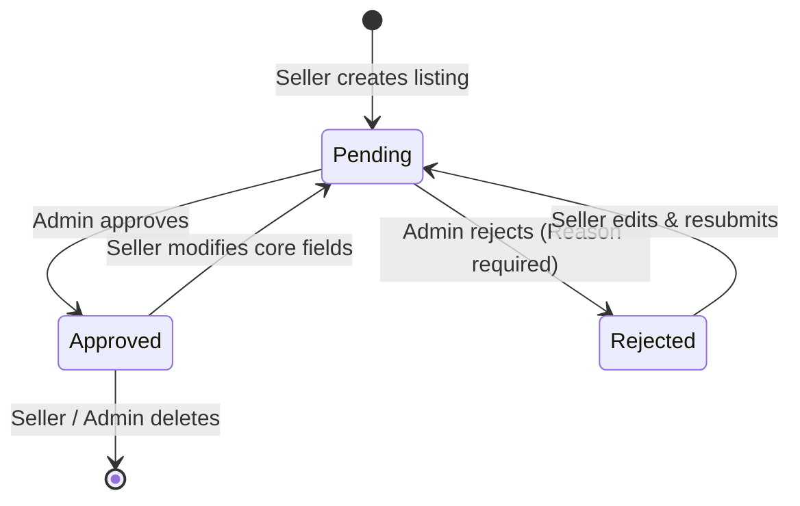
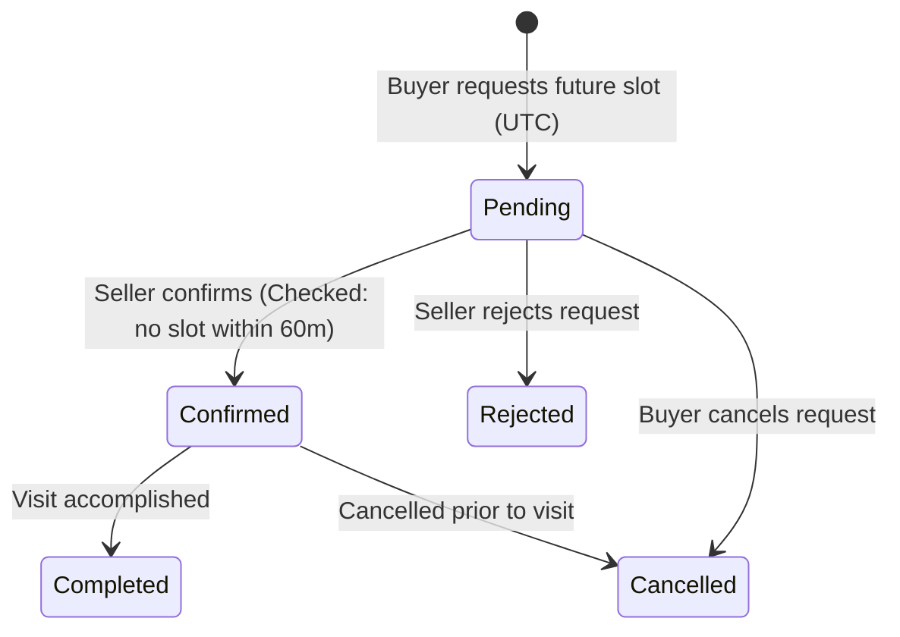

# EstateSquare — Curated Real Estate Marketplace

[](https://react.dev/)
[](https://nodejs.org/)
[](https://expressjs.com/)
[](https://www.mongodb.com/)
[](https://tailwindcss.com/)
[](https://jestjs.io/)
[](https://property-hub-gamma.vercel.app)

> A production-grade MERN marketplace tailored for the Indian real estate market, addressing unverified listings, fake duplicate posts, and open-ended scheduling chaos through **mandatory admin moderation** and a **strict 1-hour conflict-free visit state machine**.

---

## 🌐 Live Deployments

| Component | Platform | Live URL | Status |
|---|---|---|---|
| **Frontend Application** | Vercel | [https://property-hub-gamma.vercel.app](https://property-hub-gamma.vercel.app) | 🟢 Live |
| **Backend API Service** | Render | [https://property-hub-apd2.onrender.com](https://property-hub-apd2.onrender.com) | 🟢 Live |
| **System Health Check** | Render | [https://property-hub-apd2.onrender.com/health](https://property-hub-apd2.onrender.com/health) | 🟢 Active |
| **Source Code Repository** | GitHub | [https://github.com/merugu25bcs10797-rgb/Estate-square](https://github.com/merugu25bcs10797-rgb/Estate-square) | 🟢 Public |

---

## 🔐 Strict Role Boundaries (RBAC) & Evaluation Credentials

EstateSquare implements strict role-based separation of concerns:

| Role | Email | Password | Primary Capabilities & Boundaries |
|---|---|---|---|
| **Administrator** | `admin@estatesquare.com`<br>*(or `admin@propertyhub.com`)* | `AdminPassword123!` | **Moderation Only**.<br>• Approves/rejects pending listings with mandatory feedback.<br>• 🚫 **CANNOT BUY**: Cannot schedule visits, submit enquiries, or favorite listings.<br>• 🚫 **CANNOT SELL**: Cannot create or post property listings. |
| **Verified Seller** | `seller@estatesquare.com`<br>*(or `seller@propertyhub.com`)* | `Seller123!` | **Selling Only**.<br>• Creates and updates property listings (resets to `pending`).<br>• Confirms/rejects site visit requests.<br>• 🚫 Cannot book visits or enquire on listings. |
| **Home Buyer** | `buyer@estatesquare.com`<br>*(or `buyer@propertyhub.com`)* | `Buyer123!` | **Buying Only**.<br>• Searches verified approved listings.<br>• Schedules conflict-free 1-hour site visits.<br>• Submits direct owner enquiries and manages saved favorites. |

*Note: New `buyer` or `seller` accounts can also be created via the [Register Page](https://property-hub-gamma.vercel.app/register).*

---

## 💡 Problem Statement & Solution

### The Challenge
Online real estate platforms in India frequently suffer from:
1. **Duplicate Spam & Expired Listings**: Unverified brokers flood portals with outdated or non-existent flats.
2. **Scheduling Double-Bookings**: Unmoderated visit scheduling leads to overlapping time slots and wasted physical site visits.
3. **Lack of Accountability**: Owners and buyers communicate without status tracking or moderation records.

### The EstateSquare Solution
- **Mandatory Admin Moderation**: Listings submitted by sellers default to `pending` and are invisible to the public until reviewed and approved by an administrator.
- **Conflict-Free Visit State Machine**: Prevents overlapping bookings by rejecting any visit scheduled within 60 minutes of an existing confirmed slot (`|visitDate - slot| < 60 mins`).
- **Strict Role Separation**: Administrators maintain impartiality; admins cannot buy properties or post sales listings.
- **Full Audit Trail**: Rejections require structured feedback reasons; editing key listing fields automatically reverts the property back to `pending`.
- **Cross-Domain Session Security**: Authentication powered by signed JWTs stored in `HttpOnly; SameSite=None; Secure` cookies with CORS origin enforcement.

---

## 🏗️ System Architecture

```
+-----------------------------------------------------------------------------------------+
|                                    CLIENT TIER                                          |
|                     React 18 + Vite (SPA) — Hosted on Vercel                            |
|  - Tailwind CSS custom design system (Warm neutral palette, Forest green accents)      |
|  - Axios instance with credentials: true, 401 interception, and cold-start indicator    |
|  - Client-side routing with role-based Route Guards and history state replacement       |
+-----------------------------------------------------------------------------------------+
                                           │
                           HTTPS / JSON / HttpOnly Cookie
                                           │
+-----------------------------------------------------------------------------------------+
|                                    SERVER TIER                                          |
|                       Express.js (Node ESM) — Hosted on Render                          |
|  - Security: Helmet headers, rate limiting (auth routes), strict CORS origin validation |
|  - Middleware: Protect (JWT verification), RestrictTo (RBAC), Zod Schema Validator     |
|  - REST Controllers: /api/auth, /api/properties, /api/visits, /api/enquiries, /admin    |
+-----------------------------------------------------------------------------------------+
                               /                           \
+------------------------------------------+    +-----------------------------------------+
|                DATA TIER                 |    |               MEDIA TIER                |
|           MongoDB Atlas Cluster          |    |             Cloudinary SDK              |
|  - Users, Properties, Visits, Enquiries  |    |  - Max 5 images, 5MB memory stream      |
|  - Compound unique indexes & relations   |    |  - Automated asset removal on deletion  |
+------------------------------------------+    +-----------------------------------------+
```

---

## ⚙️ Core Modules & Workflows

### 1. Property Moderation Lifecycle

* Only `approved` listings appear in public search and discovery endpoints.
* Edits made by sellers to price, bedrooms, or specifications automatically reset status to `pending` for re-moderation.

### 2. Visit Scheduling & State Machine

* **Conflict Prevention**: If a seller attempts to confirm a visit within 1 hour of another confirmed visit for the same property, the server rejects with **HTTP 409 Conflict**.
* Dates are stored in UTC and rendered client-side in Indian Standard Time (IST).

---

## 📡 API Reference

### Authentication & Sessions
| Method | Endpoint | Access | Description |
|---|---|---|---|
| `POST` | `/api/auth/register` | Public | Register new `buyer` or `seller` account (admin creation blocked) |
| `POST` | `/api/auth/login` | Public | Authenticate user, issue `HttpOnly` JWT cookie |
| `POST` | `/api/auth/logout` | Public | Clear authentication cookie |
| `GET` | `/api/auth/me` | Authenticated | Retrieve current user profile from session |

### Properties & Discovery
| Method | Endpoint | Access | Description |
|---|---|---|---|
| `GET` | `/api/properties` | Public | Search approved listings with filters (`city`, `listingType`, `price`, `bedrooms`, `sort`, `page`) |
| `GET` | `/api/properties/:id` | Public | Retrieve property details (pending/rejected viewable only by Owner/Admin) |
| `GET` | `/api/properties/my` | Seller | Retrieve all listings owned by the logged-in seller |
| `POST` | `/api/properties` | Seller | Create listing with up to 5 image uploads (status: `pending`) |
| `PUT` | `/api/properties/:id` | Seller (Owner) | Update listing (resets status to `pending` for re-review) |
| `DELETE`| `/api/properties/:id` | Seller (Owner) / Admin | Delete property and remove Cloudinary assets |

### Admin Moderation
| Method | Endpoint | Access | Description |
|---|---|---|---|
| `GET` | `/api/admin/properties/pending` | Admin | Retrieve pending moderation queue |
| `PATCH`| `/api/admin/properties/:id/approve` | Admin | Approve pending listing for public visibility |
| `PATCH`| `/api/admin/properties/:id/reject` | Admin | Reject listing with required feedback note |

### Visits & Scheduling
| Method | Endpoint | Access | Description |
|---|---|---|---|
| `POST` | `/api/properties/:id/visits` | Buyer | Schedule future visit slot (Admins & Sellers forbidden) |
| `GET` | `/api/visits/my` | Buyer | View buyer's scheduled site visits |
| `GET` | `/api/visits/received` | Seller | View visit requests for seller's properties |
| `PATCH`| `/api/visits/:id/status` | Buyer / Seller | Execute state transition with 1-hr conflict check |

### Enquiries & Favorites
| Method | Endpoint | Access | Description |
|---|---|---|---|
| `POST` | `/api/properties/:id/enquiries` | Buyer | Send direct message/enquiry to property owner (Admins & Sellers forbidden) |
| `GET` | `/api/enquiries/my` | Buyer | View sent enquiries |
| `GET` | `/api/enquiries/received` | Seller | View received enquiries and update status |
| `POST` | `/api/properties/:id/favorite` | Buyer | Toggle property favorite (Admins & Sellers forbidden) |
| `GET` | `/api/favorites` | Buyer | Retrieve user's saved favorite properties |

### System & Health
| Method | Endpoint | Access | Description |
|---|---|---|---|
| `GET` | `/health` | Public | Health status, server uptime, and environment check |
| `GET` | `/seed` | Public | Idempotent database check ensuring Admin & sample data exist |

---

## 🧪 Automated Integration Tests

EstateSquare features automated end-to-end integration tests written with **Jest**, **Supertest**, and **mongodb-memory-server**:

```text
PASS tests/property.test.js
  ✓ Test 3: unauthenticated create listing -> 401
  ✓ Test 4: seller cannot edit another seller's listing -> 403
  ✓ Test 5: pending listings are absent from public search; approved ones appear
  ✓ Test 6: search filters, sort, and pagination work; invalid query params -> 400

PASS tests/visit.test.js
  ✓ Test 8: visit: past date rejected, invalid transition -> 409, double-booking -> 409

PASS tests/enquiry.test.js
  ✓ Test 9: buyer cannot read another buyer's enquiries/visits

PASS tests/favorite.test.js
  ✓ Test 7: favorites: no duplicates, idempotent remove

PASS tests/auth.test.js
  ✓ Test 1: public register can't create admin (400) and register duplicate email -> 409
  ✓ Test 2: wrong password fails safely with 401

PASS tests/health.test.js
  ✓ Test 10: /health returns ok with 200 status

Test Suites: 6 passed, 6 total
Tests:       10 passed, 10 total
Snapshots:   0 total
Time:        6.861 s
```

To execute test suites locally:
```bash
npm --prefix backend run test
```

---

## 💻 Local Development Setup

### 1. Prerequisites
* **Node.js** >= 18.0.0
* **npm** >= 9.0.0
* **MongoDB** (Atlas connection URI or in-memory mode)

### 2. Installation
```bash
# Clone the repository
git clone https://github.com/merugu25bcs10797-rgb/Estate-square.git
cd Estate-square

# Install backend dependencies
cd backend && npm install

# Install frontend dependencies
cd ../frontend && npm install
cd ..
```

### 3. Environment Configuration

Create `backend/.env`:
```env
PORT=8084
dbURL=memory
JWT_SECRET=your_super_secret_jwt_key_at_least_32_characters
CLIENT_URL=http://localhost:5173
NODE_ENV=development
ADMIN_EMAIL=admin@estatesquare.com
ADMIN_PASSWORD=AdminPassword123!
```

Create `frontend/.env`:
```env
VITE_API_URL=http://localhost:8084
```

### 4. Running the Servers
```bash
# Terminal 1: Backend API
npm --prefix backend run dev

# Terminal 2: Frontend App
npm --prefix frontend run dev
```

* Frontend: `http://localhost:5173`
* Backend API: `http://localhost:8084`

---

## 🚀 Production Deployment Reference

* **Frontend Hosting**: Vercel SPA configuration using `vercel.json` rewrite routing.
* **Backend Hosting**: Render Web Service with `trust proxy: 1`, explicit CORS headers, and cross-origin cookies (`SameSite=None; Secure`).
* **Database**: MongoDB Atlas Cluster with IP allowlist enabled (`0.0.0.0/0`).

---

## 📄 License
This project is licensed under the [MIT License](LICENSE).
